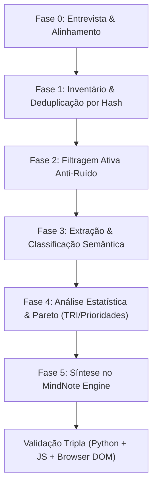

# Study Intelligence Miner - Universal Agent Skill

Esta skill define o protocolo universal para agentes autônomos realizarem **mineração cognitiva de dados de estudo**, diagnóstico de acervos brutos e síntese de inteligência para preparação acelerada em **qualquer área do conhecimento** (concursos públicos, vestibulares, certificações profissionais de tecnologia, medicina, direito, pós-graduação ou aprendizagem autodidata).

---

## 🧭 Princípio Fundamental

O agente **nunca assume previamente o conteúdo**. Diante de pastas heterogêneas de materiais brutos, o agente atua como um engenheiro de dados cognitivo:
1. Conduz uma entrevista rápida para entender o foco e delimitar filtros.
2. Descarta o ruído irrelevante sem perder dados essenciais.
3. Classifica semanticamente o cerne conceitual de cada documento ou questão.
4. Aplica a Regra de Pareto para identificar os tópicos de maior retorno sobre o tempo investido.
5. Gera artefatos estruturados e validados no motor **MindNote**.

---

## 🎙️ Fase 0: Entrevista e Alinhamento de Escopo

Antes de iniciar qualquer processamento em lote, o agente DEVE dialogar com o usuário para obter 4 parâmetros vitais:

1. **Alvo de Estudo / Objetivo**:
   - *Exemplo*: "Certificação AWS Solutions Architect (SAA-C03)", "Concurso Polícia Federal - Agente", "Residência Médica - Clínica Médica", "ENEM Dia 2".
2. **Localização e Volume do Acervo**:
   - Quais diretórios contêm os materiais brutos? (PDFs, slides, apostilas, simulados).
3. **Filtros de Exclusão e Ruído Conhecido (Anti-Ruído)**:
   - O que NÃO deve ser estudado?
   - *Exemplos*: Bancas examinadoras diferentes, legislações revogadas, matérias secundárias descartadas no edital, questões discursivas se a meta for prova objetiva, versões preliminares ou duplicadas.
4. **Horizonte Temporal e Ritmo**:
   - Quantos dias até a prova ou meta de estudo?
   - Quantas horas disponíveis por dia para dimensionar o cronograma tático diário?

---

## ⚙️ O Pipeline em 5 Fases

---

### Fase 1: Inventário & Deduplicação por Hash
- Realizar varredura recursiva nos diretórios apontados.
- Levantar tamanho total, número de arquivos e formatos presentes (`.pdf`, `.docx`, `.txt`, `.json`).
- Implementar hash estrutural (MD5/SHA-256 dos blocos textuais iniciais) para agrupar e descartar duplicatas exatas com nomes de arquivo diferentes.

### Fase 2: Filtragem Ativa Anti-Ruído
- Aplicar os critérios definidos na entrevista.
- Descartar cadernos de outros exames, matérias fora de escopo ou gabaritos comentados redundantes.
- Eleger **edições canônicas primárias** para análise estatística limpa.

### Fase 3: Extração & Classificação Semântica Profunda
- **Regra Fundamental**: Jamais utilizar buscas superficiais por palavras-chave isoladas.
- Interpretar o contexto, o raciocínio exigido e a habilidade cognitiva cobrada.
- Montar dinamicamente uma taxonomia hierárquica:
  - **Área** > **Módulo / Disciplina** > **Tópico Principal** > **Micro-Conceito**.

### Fase 4: Análise Estatística & Priorização (Curva de Pareto)
- Calcular a frequência absoluta e percentual de cada assunto no corpus.
- Dividir os assuntos por faixas de prioridade:
  - **Nível 1 - CRUCIAL (`#DC2626`)**: Assuntos de altíssima incidência e base indispensável (Top 10-20% que garantem a coerência de pontuação).
  - **Nível 2 - ALTO IMPACTO (`#D97706`)**: Tópicos frequentes que consolidam diferenciais competitivos.
  - **Nível 3 - PERIFÉRICO (`#2563EB` ou tons complementares)**: Tópicos de baixa incidência ou alta complexidade com baixo retorno de tempo.

### Fase 5: Compilação de Entregáveis & MindNote Engine
O agente deve compilar:
1. **Relatório Consolidado (`RELATORIO_CONSOLIDADO.md`)**: Panorama estatístico, ranking de prioridades e correlações interdisciplinares.
2. **Índice Temático de Exercícios (`INDICE_TEMATICO.md`)**: Seleção balanceada de questões/problemas organizados pelos tópicos prioritários.
3. **Mapa Mental Completo (`MAPA_MENTAL.json`)**:
   - Árvore hierárquica compatível com o MindNote Engine.
   - Cada nó deve conter estritamente as 4 chaves: `titulo`, `anotacao`, `cor`, `filhos`.
   - Nós intermediários: `"anotacao": null`.
   - Nós folha: `"anotacao": { "tipo": "pauta", "linhas_manuais": N }` ou `"tipo": "ilustracao"`.
4. **Cronograma Tático Reta Final (`CRONOGRAMA_RETA_FINAL.json`)**:
   - Raízes organizadas pelos dias disponíveis (ex: Dia 1, Dia 2, etc.).
   - Filtrar apenas tópicos de Nível 1 e Nível 2.
   - Folhas com `"anotacao": { "tipo": "pauta", "linhas_manuais": 3 }` para memorização ativa de fórmulas, prazos e macetes.

---

## 🧪 Protocolo Obrigatório de Validação Tripla

Nenhum arquivo JSON deve ser entregue sem homologação nas 3 camadas:

1. **Camada 1 (Python AST & Schema Check)**:
   - Validação de integridade sintática, chaves obrigatórias e ausência de escapes inválidos.
2. **Camada 2 (Node.js Engine)**:
   - Simulação das funções de cálculo geométrico e layout de árvore do MindNote.
3. **Camada 3 (Headless Browser DOM Validation)**:
   - Injeção em navegador headless (MS Edge / Chromium) verificando ausência de erros em console e contagem real de nós SVG e caixas pautadas.

